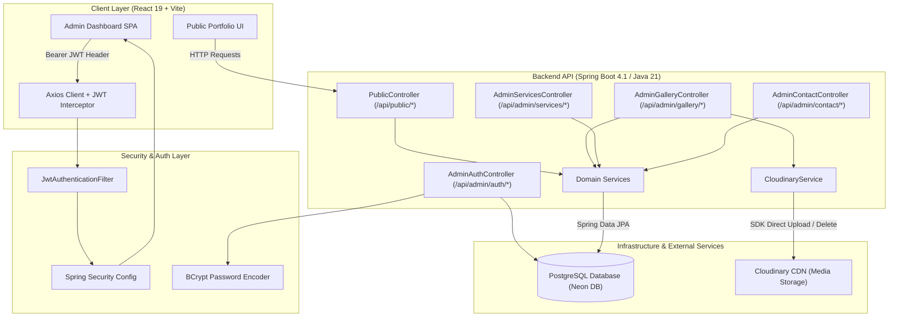
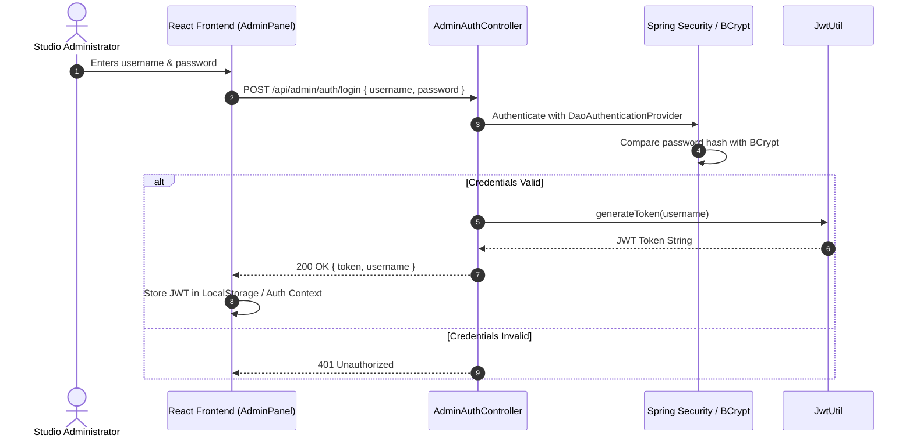
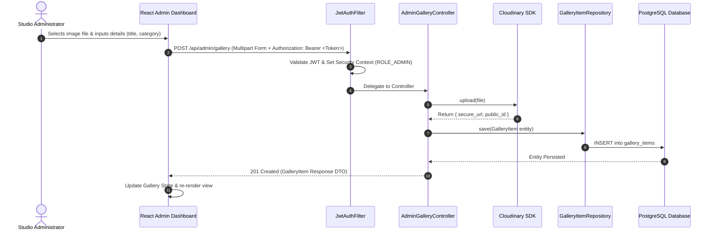
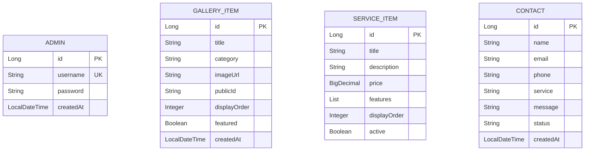

# 📸 Aravinth Photography Studio CMS — Architecture & System Documentation

Welcome to the **Aravinth Photography Studio Content Management System (CMS)** repository. This full-stack application provides a high-performance, responsive public portfolio website for clients, backed by a secure RESTful administration portal for studio management, gallery curation, package configuration, and client message handling.

---

## 📐 System Architecture Overview

The application follows a **decoupled Client-Server Architecture** with a React-based Single Page Application (SPA) on the frontend, a Spring Boot REST API on the backend, PostgreSQL for relational data storage, and Cloudinary for media asset management.



---

## 🛠️ Technology Stack

| Layer | Technology | Purpose / Highlights |
| :--- | :--- | :--- |
| **Frontend Framework** | React 19 + Vite | Fast HMR, component-driven UI architecture |
| **Styling & Motion** | Tailwind CSS v4 + Framer Motion | Dynamic visual aesthetics, glassmorphism, responsive UI |
| **Icons & Router** | Lucide React + React Router v7 | Clean modern icon sets & SPA client routing |
| **HTTP Client** | Axios | REST client with request interceptors for JWT injection |
| **Backend Framework** | Spring Boot 4.1.0 (Java 21) | Enterprise REST API, dependency injection, JPA |
| **Security & Auth** | Spring Security + JJWT 0.12.6 | Stateless JWT authentication, role-based authorization (`ROLE_ADMIN`) |
| **Database & ORM** | PostgreSQL + Spring Data JPA | Relational data persistence with Hibernate ORM |
| **Cloud Storage** | Cloudinary Java SDK 2.4.0 | Multi-part image uploads, cloud asset deletion, CDN delivery |
| **Containerization** | Docker | Production container image configuration for backend runtime |

---

## 📁 Repository & Directory Structure

```
AravinthStudioCMSPort/
├── README.md                      # Primary Architecture & Project Documentation
├── client/                        # React Frontend (Single Page Application)
│   ├── public/                    # Static public assets
│   ├── src/
│   │   ├── api/
│   │   │   └── api.js             # Axios instance & centralized API endpoints
│   │   ├── components/            # Reusable UI components
│   │   │   ├── Navbar.jsx         # Site navigation bar
│   │   │   ├── Hero.jsx           # Landing hero section
│   │   │   ├── About.jsx          # Studio overview & statistics
│   │   │   ├── Gallery.jsx        # Category-filtered portfolio grid
│   │   │   ├── Services.jsx       # Service packages grid
│   │   │   ├── WhyChooseUs.jsx    # Studio feature highlights
│   │   │   ├── Contact.jsx        # Client booking & inquiry form
│   │   │   ├── Footer.jsx         # Studio footer & social links
│   │   │   └── DeleteConfirmationModal.jsx # Admin delete dialog
│   │   ├── pages/
│   │   │   └── AdminPanel.jsx     # Admin Dashboard (Tabbed CMS Control)
│   │   ├── App.jsx                # Core application routing & layout
│   │   ├── main.jsx               # Application entry point
│   │   └── index.css              # Global styles & Tailwind CSS configuration
│   ├── package.json
│   └── vite.config.js
└── server/                        # Spring Boot REST API Backend
    ├── Dockerfile                 # Backend containerization spec
    ├── pom.xml                    # Maven configuration & dependency manifests
    └── src/
        └── main/
            ├── java/com/example/photoStudio/
            │   ├── PhotoStudioApplication.java # Spring Boot Main Class
            │   ├── config/        # Global CORS & application beans
            │   ├── controller/    # Public & Admin REST Controllers
            │   ├── dto/           # Data Transfer Objects (Requests/Responses)
            │   ├── entity/        # JPA Database Entities (Admin, GalleryItem, ServiceItem, Contact)
            │   ├── exception/     # Custom Exception Handlers
            │   ├── mapper/        # DTO-Entity conversion mappers
            │   ├── repository/    # Spring Data JPA Repositories
            │   ├── security/      # Spring Security, JwtAuthFilter, JwtUtil
            │   ├── service/       # Business Logic & Cloudinary Integration
            │   └── utility/       # Helper utilities
            └── resources/
                ├── application.properties # Spring configuration & environment references
                └── seed_data.sql          # Initial database database seed data
```

---

## 🔒 Authentication & Data Flow

### 1. Admin Authentication Flow



### 2. Authenticated Media Upload & Curation Flow



---

## 🗄️ Database Domain Model



---

## 📡 REST API Endpoint Specifications

### Public Endpoints (`/api/public/*`) — No Auth Required

| Method | Endpoint | Description |
| :--- | :--- | :--- |
| `GET` | `/api/public/gallery` | Retrieve published gallery items |
| `GET` | `/api/public/services` | Retrieve active studio service packages |
| `POST` | `/api/public/contact` | Submit a client inquiry/booking message |

### Authentication Endpoint (`/api/admin/auth/*`)

| Method | Endpoint | Request Body | Description |
| :--- | :--- | :--- | :--- |
| `POST` | `/api/admin/auth/login` | `{ "username": "...", "password": "..." }` | Authenticate admin & receive JWT Bearer token |

### Protected Admin Endpoints (`/api/admin/*`) — Requires `ROLE_ADMIN` Header

| Category | Method | Endpoint | Description |
| :--- | :--- | :--- | :--- |
| **Gallery** | `GET` | `/api/admin/gallery` | List all gallery items |
| | `POST` | `/api/admin/gallery` | Upload new photo to Cloudinary & persist item metadata |
| | `PUT` | `/api/admin/gallery/{id}` | Update gallery item metadata |
| | `DELETE` | `/api/admin/gallery/{id}` | Delete item from PostgreSQL & remove image from Cloudinary |
| **Services**| `GET` | `/api/admin/services` | List all service packages |
| | `POST` | `/api/admin/services` | Create new service package |
| | `PUT` | `/api/admin/services/{id}` | Update service package |
| | `DELETE` | `/api/admin/services/{id}` | Remove service package |
| **Contacts**| `GET` | `/api/admin/contacts` | List client contact inquiries |
| | `PUT` | `/api/admin/contacts/{id}/status` | Update message status (`NEW`, `READ`, `RESPONDED`) |
| | `DELETE` | `/api/admin/contacts/{id}` | Delete client contact message |

---

## 🚀 Environment Setup & Deployment Guide

### Environment Variables Matrix

The backend supports **seamless dual-mode configuration**:
1. **Local Development Mode**: Uses safe default fallbacks if environment variables are not set.
2. **Production Mode (Render)**: Environment variables automatically override fallback values without code changes.

| Environment Variable | Description | Local Development Fallback | Production (Render) |
| :--- | :--- | :--- | :--- |
| `SPRING_DATASOURCE_URL` | PostgreSQL JDBC connection URL | Preconfigured Neon DB cluster | Required |
| `SPRING_DATASOURCE_USERNAME` | PostgreSQL database user | `neondb_owner` | Required |
| `SPRING_DATASOURCE_PASSWORD` | PostgreSQL database password | Encrypted cluster secret | Required |
| `JWT_SECRET` | Secret key for signing JWT tokens | Local 256-bit development key | Required |
| `JWT_EXPIRATION` | Token expiration time in milliseconds | `86400000` (24 Hours) | Optional (defaults to 24h) |
| `CLOUDINARY_CLOUD_NAME` | Cloudinary cloud account name | `fknwgvhm` | Required |
| `CLOUDINARY_API_KEY` | Cloudinary REST API key | `429123935655556` | Required |
| `CLOUDINARY_API_SECRET` | Cloudinary REST API secret | `iAnQqEaRmi7n8t5fTKtF1rnBdUI` | Required |

---

### Running the Application Locally

#### Option A: Using a `.env` File (Recommended)
Create a `.env` file inside the `server/` directory (or copy from `server/.env.example`). The Spring Boot application automatically loads properties from `server/.env` on startup using `dotenv-java`:

```env
# server/.env
SPRING_DATASOURCE_URL=jdbc:postgresql://localhost:5432/photoStudio
SPRING_DATASOURCE_USERNAME=postgres
SPRING_DATASOURCE_PASSWORD=password

JWT_SECRET=myLocalSuperSecretKeyForJWTSigning2026!
JWT_EXPIRATION=86400000

CLOUDINARY_CLOUD_NAME=my_cloud_name
CLOUDINARY_API_KEY=1234567890
CLOUDINARY_API_SECRET=my_api_secret
```

Then start the server normally:
```bash
cd server
./mvnw spring-boot:run
```

#### Option B: Running with Default Fallbacks (Zero Configuration)
If no `.env` file or environment variables are present, the application will use local fallbacks from `application.properties`:

```bash
cd server
./mvnw spring-boot:run
```

#### Option C: Running with Environment Variables (CLI / IDE)

##### Windows Command Prompt (CMD)
```cmd
set JWT_SECRET=myLocalSuperSecretKeyForJWTSigning2026!
set JWT_EXPIRATION=86400000
set SPRING_DATASOURCE_URL=jdbc:postgresql://localhost:5432/photoStudio
set SPRING_DATASOURCE_USERNAME=postgres
set SPRING_DATASOURCE_PASSWORD=password
set CLOUDINARY_CLOUD_NAME=my_cloud_name
set CLOUDINARY_API_KEY=1234567890
set CLOUDINARY_API_SECRET=my_api_secret

cd server
mvnw spring-boot:run
```

##### Windows PowerShell
```powershell
$env:JWT_SECRET="myLocalSuperSecretKeyForJWTSigning2026!"
$env:JWT_EXPIRATION="86400000"
$env:SPRING_DATASOURCE_URL="jdbc:postgresql://localhost:5432/photoStudio"
$env:SPRING_DATASOURCE_USERNAME="postgres"
$env:SPRING_DATASOURCE_PASSWORD="password"
$env:CLOUDINARY_CLOUD_NAME="my_cloud_name"
$env:CLOUDINARY_API_KEY="1234567890"
$env:CLOUDINARY_API_SECRET="my_api_secret"

cd server
.\mvnw spring-boot:run
```

##### VS Code / IntelliJ IDEA Run Configuration
In your IDE Run/Debug configuration for `PhotoStudioApplication`:
1. Open **Edit Configurations** -> **Environment Variables**.
2. Add key-value pairs:
   ```text
   JWT_SECRET=myLocalSuperSecretKeyForJWTSigning2026!;JWT_EXPIRATION=86400000;SPRING_DATASOURCE_URL=jdbc:postgresql://localhost:5432/photoStudio;SPRING_DATASOURCE_USERNAME=postgres;SPRING_DATASOURCE_PASSWORD=password;CLOUDINARY_CLOUD_NAME=my_cloud_name;CLOUDINARY_API_KEY=1234567890;CLOUDINARY_API_SECRET=my_api_secret
   ```
3. Save and launch the application.

---

### Production Deployment (Render)

When deploying to **Render**, add all required environment variables in the Render Dashboard:

1. Go to **Render Dashboard** -> Select your Web Service.
2. Navigate to **Environment** -> **Add Environment Variable**.
3. Configure the following keys and values:

```env
SPRING_DATASOURCE_URL=jdbc:postgresql://ep-snowy-firefly-ao3holkd-pooler.c-2.ap-southeast-1.aws.neon.tech/neondb?sslmode=require
SPRING_DATASOURCE_USERNAME=neondb_owner
SPRING_DATASOURCE_PASSWORD=<YOUR_PRODUCTION_NEON_PASSWORD>

JWT_SECRET=<YOUR_PRODUCTION_SECURE_JWT_SECRET_256BIT>
JWT_EXPIRATION=86400000

CLOUDINARY_CLOUD_NAME=<YOUR_CLOUDINARY_CLOUD_NAME>
CLOUDINARY_API_KEY=<YOUR_CLOUDINARY_API_KEY>
CLOUDINARY_API_SECRET=<YOUR_CLOUDINARY_API_SECRET>
```

4. Click **Save Changes**. Render will trigger an automatic redeployment using the production environment variables.

---

### Frontend Client Setup

#### Running React Frontend Locally
```bash
cd client
npm install
npm run dev
```
*Client will be available on `http://localhost:5173`*

